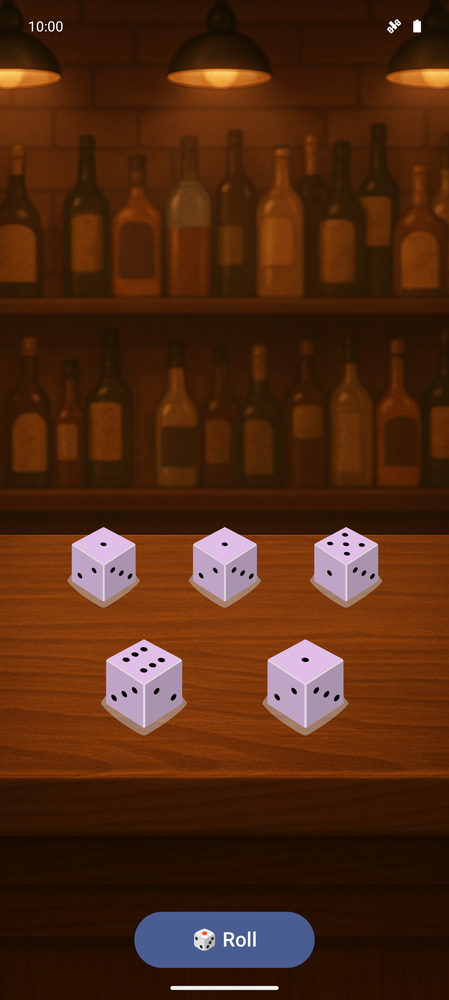

# Combo Dice

Android dice game developed for **Programação Avançada de Dispositivos Móveis** at Universidade Autónoma de Lisboa (June 2025).

Roll five dice with a button or a shake of your phone, discover the resulting combination, and receive animated feedback. The project uses Kotlin and Jetpack Compose, with custom scoring inspired by Yahtzee and Poker Dice.

## Features

- **Five-dice rolls:** each roll generates five new values. The dice change faces and rotate during the animation before settling on the result.
- **Button and motion controls:** tap **Roll** or shake a device with an accelerometer. Shake detection uses a threshold and debounce interval, and sensor registration follows the activity lifecycle.
- **Combination recognition:** the app identifies pairs, three/four/five of a kind, full houses, and two straight sequences, then displays the combination and its points.
- **Sound and vibration:** a dice-roll sound and haptic feedback accompany each roll on supported devices.
- **Result feedback:** higher-scoring results trigger confetti, while other results display playful messages. Input is locked during the roll and result display to prevent overlapping rolls.
- **Compose interface:** a tavern-themed background, illustrated dice, loading indicator, and temporary result overlays form a single-screen game.

Each roll is independent: the displayed points belong to that roll. All five dice are rolled together.

## Scoring

Combo Dice uses custom scoring rules. The two straights require the exact sequences shown below.

| Combination | Dice pattern (any order) | Points |
| --- | --- | ---: |
| Five of a Kind | Five matching values | 50 |
| Four of a Kind | Four matching values | 40 |
| Full House | Three matching values and a pair | 35 |
| Large Straight | 2, 3, 4, 5, 6 | 30 |
| Small Straight | 1, 2, 3, 4, 5 | 25 |
| Three of a Kind | Three matching values and two different single values | 20 |
| Two Pair | Two different pairs and one other value | 15 |
| One Pair | One pair and three different single values | 10 |
| No Combination | Any remaining result | 0 |

## Technology

| Component | Project configuration |
| --- | --- |
| Language | Kotlin 2.0.21 |
| UI | Jetpack Compose, Material 3 |
| Compose BOM | 2024.09.00 |
| Android Gradle Plugin | 8.10.1 |
| Gradle wrapper | 8.11.1 |
| Android SDK | Compile / target API 35 |
| Minimum Android version | Android 7.0 (API 24) |
| Confetti | Konfetti Compose 2.0.4 |

The app runs locally. No backend, database, account, or API credentials are required. Internet access is needed to download development tools and build dependencies.

## Run Locally

### 1. Install the development tools

Install [Android Studio](https://developer.android.com/studio) with support for Android Gradle Plugin 8.10.1.

In **SDK Manager**, install:

- Android SDK Platform 35.
- Android SDK Build-Tools 35.0.0.
- Android SDK Platform-Tools.
- Android Emulator and a system image if you plan to use a virtual device.

Use **JDK 17** as the Gradle baseline. A debug build also passed on Windows with **JDK 21.0.8**. The app targets Java/Kotlin bytecode version 11. See the [AGP 8.10 compatibility table](https://developer.android.com/build/releases/agp-8-10-0-release-notes) for the build requirements.

### 2. Open and sync the project

1. Clone this repository or extract its downloaded ZIP.
2. In Android Studio, choose **Open** and select the root folder containing `settings.gradle.kts`, not the `app` subfolder.
3. In **Settings > Build, Execution, Deployment > Build Tools > Gradle**, select the JDK you installed for Gradle.
4. Allow Gradle sync and dependency downloads to finish. Use the included Gradle wrapper; no separate Gradle installation is needed.
5. Keep the existing dependency versions for the first build before accepting upgrade suggestions.

Android Studio normally creates `local.properties` with the local Android SDK path. This machine-specific file is ignored by Git and should remain local.

### 3. Select a device and run

- **Physical device:** use Android 7.0 or newer, enable Developer options and USB debugging, connect it, and accept the debugging prompt.
- **Emulator:** create a device in Android Studio's Device Manager using API 24 or newer. API 35 is a useful starting point.

Select the **app** run configuration and your device, then click **Run**. Tap **Roll** to play. A physical device is best for checking shake detection and vibration.

## Acknowledgments

The project builds on the official Android Dice Roller codelab. The five-dice gameplay, custom combinations, shake interaction, and audiovisual feedback extend that starting point. The dice vectors retain their Android Open Source Project notices. The [Apache 2.0 license text](LICENSES/Apache-2.0.txt) accompanies those resources, the adapted tutorial material, and the Gradle wrapper. [Android Dice Roller codelab](https://developer.android.com/codelabs/basic-android-kotlin-compose-build-a-dice-roller-app)

Confetti effects use [Konfetti](https://github.com/DanielMartinus/Konfetti).

Created as an individual university project for educational and demonstration purposes.
